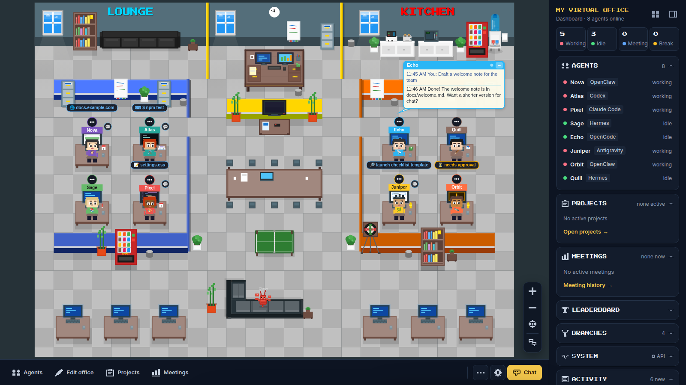

# My Virtual Office

🌐 **[myvirtualoffice.ai](https://myvirtualoffice.ai/)**

A self-hosted 2D AI workspace for AI Agents. Turn invisible agent work into a living, breathing office.



## What Is It?

Virtual Office gives your AI agents a physical presence. Instead of watching logs scroll by, you see agents walking between desks, grabbing coffee, sitting in meetings, and chatting in a charming 2D style office that runs in your browser.

It connects to supported agent harnesses and visualizes what your agents are doing in real time.

## Supported Agent Harnesses

### OpenClaw

Virtual Office connects to OpenClaw through the OpenClaw gateway and the mounted OpenClaw home directory. The gateway provides live chat and activity events, while the home directory lets Virtual Office discover agents, read safe profile metadata, load model settings, and surface workspace tools in the UI.

For Docker deployments, mount your OpenClaw home directory into the container and set `VO_OPENCLAW_PATH`, `VO_GATEWAY_URL`, and `VO_GATEWAY_HTTP` when the defaults do not match your setup.

### Hermes Agents

Virtual Office can connect Hermes as a first-class office agent through the Hermes API Server, a reachable Hermes Desktop Backend, or the Hermes CLI/home directory as an optional fallback for profile discovery and profile management. Native API chat uses Hermes' `/v1/runs` and SSE event stream when the API server is available. Desktop Backend chat uses the documented `hermes serve` TUI-gateway JSON-RPC/WebSocket surface. Local Virtual Office history is stored under `VO_STATUS_DIR`.

For Docker deployments, point `VO_HERMES_API_URL` at the host gateway, usually `http://host.docker.internal:8642`, and set `VO_HERMES_API_KEY` to the Hermes `API_SERVER_KEY`. If using Desktop Backend mode with an already-open Desktop app, set `VO_HERMES_DESKTOP_URL` to the loopback URL that Desktop's `hermes serve` backend is bound to, such as `http://127.0.0.1:62353`. Docker-hosted Virtual Office routes loopback Desktop URLs through `host.docker.internal` while preserving Hermes' expected `127.0.0.1:<port>` Host identity. The setup/settings Auto Discover button can use an exposed Desktop readiness log path, a previously entered URL, or visible loopback listeners; Docker still cannot reliably discover a private host Desktop port unless that port or log is exposed to the container. Mount or otherwise expose the Hermes home directory and CLI path only when you want CLI fallback/profile management. Hermes secrets, private memory files, and config internals are not read or exposed.

Virtual Office also ships a Hermes Messaging Gateway platform plugin under `integrations/hermes-platform/my_virtual_office/`. This is a different mode: Hermes gateway connects to Virtual Office as a messaging platform, so the `Hermes Gateway` office agent can receive queued Virtual Office messages and post replies back into visible office chat. Configure `VO_HERMES_PLATFORM_TOKEN` on Virtual Office, copy the plugin into `~/.hermes/plugins/my_virtual_office/`, set `MY_VIRTUAL_OFFICE_URL` and `MY_VIRTUAL_OFFICE_TOKEN` for Hermes, then run `hermes gateway`.

### Codex

Virtual Office can create Codex-backed office agents when the Codex CLI is available to the app. Chat uses Codex's native `codex app-server` JSON-RPC protocol for thread start/resume, live progress, approval requests, and interrupt support. `codex exec` is retained only as an explicit compatibility fallback.

Discovery includes Virtual Office-created Codex agents, Codex's standard `$CODEX_HOME/agents/*.toml` custom agents, and a synthesized `Main` entry for the default Codex root agent. Newly created Virtual Office Codex agents can use the default Codex agents directory or a custom parent directory. Default-directory creation registers a native custom-agent TOML file under `$CODEX_HOME/agents` when `VO_CODEX_REGISTER_NATIVE_AGENTS=1`; custom-directory creation writes a project-local `.codex/agents/<profile>.toml` and keeps a small Virtual Office registry so the agent remains discoverable.

For Docker deployments, install Codex inside the container image or set `VO_CODEX_BIN` to a Codex executable path available inside the container. Set `VO_CODEX_HOME` to a deployment-specific Codex home so auth and config stay out of the repo and are not tied to any developer's machine. Useful variables: `VO_CODEX_BIN`, `VO_CODEX_HOME`, `VO_CODEX_WORKSPACE_ROOT`, `VO_CODEX_MAIN_WORKSPACE`, `VO_CODEX_INCLUDE_MAIN`, `VO_CODEX_INCLUDE_NATIVE_AGENTS`, `VO_CODEX_REGISTER_NATIVE_AGENTS`, `VO_CODEX_PREFER_APP_SERVER`, `VO_CODEX_SANDBOX`, and `VO_CODEX_APPROVAL_POLICY`. The Docker example defaults `VO_CODEX_SANDBOX` to `danger-full-access` because Codex's bubblewrap sandbox usually needs extra container privileges; set it to a stricter Codex sandbox mode when your deployment supports it.

### Claude Code

Virtual Office can create Claude Code-backed office agents when the Claude Code CLI is available to the app. Chat uses Claude Code's native non-interactive stream protocol, `claude -p --output-format stream-json --include-partial-messages`, so text deltas, tool calls, tool results, usage, session IDs, interrupts, and local Virtual Office chat history work like the other native harness providers.

Discovery includes Virtual Office-created Claude Code agents, Claude Code's native `$CLAUDE_CONFIG_DIR/agents/*.md` subagents, and a synthesized `Main` entry for Claude Code's default workspace agent. Newly created Virtual Office Claude Code agents can use the default managed workspace root or a custom parent directory. Standard creation writes `AGENTS.md`, `CLAUDE.md`, project `.claude/agents/<profile>.md`, and, when `VO_CLAUDE_CODE_REGISTER_NATIVE_AGENTS=1`, a native `$CLAUDE_CONFIG_DIR/agents/<profile>.md` subagent file. Custom creation writes the project-local subagent file and a small Virtual Office registry entry so the agent remains discoverable.

For Docker deployments, install Claude Code inside the container image or set `VO_CLAUDE_CODE_BIN` to a Claude executable path available inside the container. Set `VO_CLAUDE_CODE_HOME` to a deployment-specific Claude config directory so auth and config stay out of the repo and are not tied to any developer's machine. Useful variables: `VO_CLAUDE_CODE_BIN`, `VO_CLAUDE_CODE_HOME`, `VO_CLAUDE_CODE_WORKSPACE_ROOT`, `VO_CLAUDE_CODE_MAIN_WORKSPACE`, `VO_CLAUDE_CODE_MODEL`, `VO_CLAUDE_CODE_PERMISSION_MODE`, `VO_CLAUDE_CODE_INCLUDE_MAIN`, `VO_CLAUDE_CODE_INCLUDE_NATIVE_AGENTS`, and `VO_CLAUDE_CODE_REGISTER_NATIVE_AGENTS`.

### OpenCode

Virtual Office can create OpenCode-backed office agents when the OpenCode CLI is installed and `VO_OPENCODE_ENABLED=1`. Chat uses OpenCode's documented `opencode run --format json` CLI surface, so Virtual Office can stream text events into chat, surface tool activity, detect permission/approval events, pass uploaded files with `--file`, resume with `--session` or `--continue`, and export prior native sessions with `opencode export`.

Discovery includes Virtual Office-created OpenCode agents, markdown agents parsed from `$OPENCODE_CONFIG_DIR/agents`, project-local `.opencode/agents`, and a synthesized `Main` entry for the default workspace. Newly created standard agents write managed workspace metadata plus OpenCode markdown agent files with `mode: primary`; custom-directory agents write a project-local OpenCode agent file and a Virtual Office registry entry.

Approval support follows the available CLI contract: Virtual Office queues the approval card and, if approved, reruns that turn once with OpenCode `--auto`. Provider subprocesses run with a minimal environment; only a small safe default set plus keys listed in `VO_OPENCODE_ENV_ALLOWLIST` are passed through.

For Docker deployments, install OpenCode inside the container or point to its binary. Useful variables: `VO_OPENCODE_ENABLED`, `VO_OPENCODE_BIN`, `VO_OPENCODE_CONFIG_DIR`, `VO_OPENCODE_WORKSPACE_ROOT`, `VO_OPENCODE_MAIN_WORKSPACE`, `VO_OPENCODE_MODEL`, `VO_OPENCODE_TIMEOUT_SEC`, `VO_OPENCODE_INCLUDE_MAIN`, `VO_OPENCODE_INCLUDE_AGENTS`, `VO_OPENCODE_REGISTER_AGENTS`, and `VO_OPENCODE_ENV_ALLOWLIST`.

### Antigravity (agy)

Virtual Office integrates with Antigravity (agy) for static analysis, quick reviews, and prompt-driven agent tasks when `VO_ANTIGRAVITY_ENABLED=1`. Antigravity uses the documented one-shot CLI execution mode (`agy --print`), with optional `--model`, `--sandbox`, and `--print-timeout`. Virtual Office streams stdout lines into chat and stores local office history for the Antigravity agent.

Discovery exposes a single Antigravity office agent when `agy` is available. Because this CLI surface is stateless, Virtual Office does not claim native Antigravity session list/delete, provider-native tools, or provider-native approval response support. Uploaded file paths are included in the prompt text for context; OpenCode-style native file parts are only used where the provider CLI documents a file flag.

For Docker deployments, provide the agy executable. Useful variables: `VO_ANTIGRAVITY_ENABLED`, `VO_ANTIGRAVITY_BIN`, `VO_ANTIGRAVITY_WORKSPACE_ROOT`, `VO_ANTIGRAVITY_TIMEOUT_SEC`, `VO_ANTIGRAVITY_PRINT_TIMEOUT`, `VO_ANTIGRAVITY_MODEL`, `VO_ANTIGRAVITY_SANDBOX`, and `VO_ANTIGRAVITY_ENV_ALLOWLIST`.


## Features

### 🏢 Live Office Canvas
- Real-time 2D style office with agents that walk, sit, work, and interact
- Agents move to their desks when working, wander when idle, visit the kitchen, lounge on the couch
- Smooth A* pathfinding with collision avoidance
- Wall occlusion: agents behind walls get naturally shadowed
- 100 FPS rendering with configurable canvas size

### 🎨 Full Office Editor
- Drag-and-drop furniture placement with snap-to-grid
- 25+ furniture items: desks, boss desk, meeting table, couches, bookshelves, whiteboards, filing cabinets, plants, vending machines, kitchen appliances, ping pong table, dart board, TV, and more
- Interior wall builder: create rooms, hallways, and departments with doors
- Wall color picker per section with accent and trim colors
- Floor tile color customization
- Rotation support for select furniture (couch)
- Text labels for naming rooms and areas

### 👤 Agent Customization
- Full character appearance editor: skin tone, hair style/color, eye color, eyebrows
- Facial hair, glasses, headwear options
- Costumes (lobster suit, capes, etc.)
- Held items and desk accessories (coffee mug, envelope, clipboard, plant, etc.)
- Gender-aware sprite rendering
- Each agent gets a unique color tag and emoji

### 🐾 Office Pet
- Choose from Cat, Pug, or Lobster
- Realistic behavior: sleeping, sitting, grooming, wandering, greeting agents, investigating furniture
- Agents interact with the pet: petting (♥) and playful chasing
- Full pathfinding and collision avoidance, same as agents
- Directional walking sprites (front, back, side views) for cat and pug
- Custom naming: default pet is a lobster named Clawy

### 💬 Chat with Agents
- Click any agent to open a chat window
- Full markdown rendering with syntax highlighting
- Inline image support: send images and see thumbnails in the chat
- Click images for full-size lightbox view
- Voice input via Whisper STT (premium)
- File attachments with drag-and-drop or paste
- Audio file auto-transcription
- Streaming responses with live typing indicator
- Tool activity feed showing what the agent is doing (exec, read, write, search, etc.)
- Movable/snappable chat window with float mode
- Agent selector dropdown to switch between agents

### 📊 Dashboard Panel
- **PC Performance**: live CPU and RAM monitoring
- **API Usage**: track agent API calls and costs
- **Branch Management**: organize agents into departments/teams with color-coded borders
- **Agent Directory**: see all agents with live status (working, idle, meeting, break)
- **Activity Log**: real-time feed of office events

### 🌦️ Dynamic Environment
- **Interactive windows** with live weather pulled from your location
- **Day/night cycle**: ambient lighting shifts throughout the day
- **Animated furniture**: TV with 5 channels (sports, news, cooking, cartoon, movie) that agents walk over to watch
- **Clock** showing real time

### 📋 Meeting System
- 1-on-1 meetings: agents walk to each other's desks
- Group meetings: agents gather around the meeting table (10 seats, 5 per side)
- Meetings triggered by agent activity or manual scheduling
- Meeting status visible in dashboard

### 🏗️ Branch System
- Create departments (Engineering, Sales, Support, etc.)
- Color-coded wall sections per branch
- Agents assigned to branches with visual grouping
- Branch themes and emoji customization

### 🔧 Additional Tools (Premium)
- **Agent Browser**: embedded browser with live view, URL bar, and remote control
- **SMS Panel**: Twilio integration for SMS/phone from the office
- **Cron Manager**: schedule recurring agent tasks visually
- **Models Panel**: per-agent model switching from the UI
- **Whisper STT**: voice-to-text input in chat

## Quick Start

### Docker Compose (recommended)

```bash
git clone https://github.com/eliautobot/my-virtual-office.git
cd my-virtual-office
docker compose up -d
```

Then open `http://localhost:8090/setup` to run the setup wizard.

### Docker Image / Platform Support

The published Docker image is available at:
- `ghcr.io/eliautobot/my-virtual-office:latest`

Multi-arch images are published for:
- `linux/amd64`
- `linux/arm64`

That means the same image tag works on standard x86_64 machines and ARM64 devices like a Raspberry Pi 5.

### First Run

1. Open `http://localhost:8090/setup`
2. Follow the setup wizard to connect OpenClaw, Hermes Agents, Codex, Claude Code, OpenCode, Antigravity, or the providers you use
3. Enter a license key or skip for demo mode
4. Customize your office, add agents, and watch them come to life

## Remote Access and Security

**Recommended remote access: use [Tailscale](https://tailscale.com/).**

Virtual Office is a control surface for your local agent harnesses. If you want to reach it away from home, the safest default is to keep it on your private machine or LAN and access it over a private tailnet such as Tailscale.

### Recommended setup
- Keep Virtual Office bound to your local machine, LAN, or private tailnet
- Use Tailscale to reach the host remotely instead of opening router ports
- Keep your agent harnesses and Virtual Office behind trusted access controls
- Use strong device/account security on the machines that can reach your tailnet

### Warning
- **Do not expose Virtual Office directly to the public internet unless you fully understand and accept the security risk**
- Avoid simple port forwarding for ports `8090`, `8091`, or your agent harness gateways
- If someone can reach your Virtual Office deployment, they may be able to interact with a live control surface for your agents

This project is designed first for self-hosted local/private-network use. You are responsible for securing any remote deployment.

## Modes

### Free Demo
Works without a license key:
- Up to 3 agents
- Branch management
- Weather and day/night cycle
- Chat with any agent
- API usage monitoring
- Setup wizard

Demo mode shows a watermark and demo banner.

### Full License
Unlocks everything:
- Unlimited agents
- Full office editor and furniture
- Agent customization and appearance editor
- Office pet
- Agent Browser panel
- SMS / Twilio panel
- Cron Job Manager
- Whisper STT voice input
- No watermark or demo banner

### How to Activate
Activate during the setup wizard or later from **☰ Menu → Settings**.

License keys are provided after purchase and look like this:
```
xxxxxxxx-xxxx-xxxx-xxxx-xxxxxxxxxxxx
```

Enter your key during setup or in **☰ Menu → Settings**. The key is validated once online with Lemon Squeezy, then works offline forever. Premium features unlock immediately and persist across restarts and updates.

## Configuration

All settings live in `vo-config.json`. Environment variables override config values.

| Variable | Default | Description |
|----------|---------|-------------|
| `VO_OFFICE_NAME` | Virtual Office | Office display name |
| `VO_PORT` | 8090 | HTTP server port |
| `VO_WS_PORT` | 8091 | WebSocket proxy port |
| `VO_GATEWAY_URL` | ws://127.0.0.1:18789 | OpenClaw gateway WebSocket URL |
| `VO_GATEWAY_HTTP` | http://127.0.0.1:18789 | OpenClaw gateway HTTP URL |
| `VO_OPENCLAW_PATH` | ~/.openclaw | Path to OpenClaw home directory |
| `VO_HERMES_ENABLED` | true | Enable Hermes API Server, Desktop Backend, and optional CLI discovery |
| `VO_HERMES_API_URL` | http://127.0.0.1:8642, or http://host.docker.internal:8642 in Docker | Hermes API Server URL |
| `VO_HERMES_API_KEY` | *(none)* | Hermes `API_SERVER_KEY` for `/v1/*` requests |
| `VO_HERMES_DESKTOP_URL` | *(none)* | Optional reachable Hermes Desktop Backend / `hermes serve` URL |
| `VO_HERMES_DESKTOP_TCP_HOST` | *(auto for loopback Docker URLs)* | Optional physical TCP host used when Docker must reach a loopback-bound Desktop backend |
| `VO_HERMES_DESKTOP_TCP_PORT` | *(auto from Desktop URL)* | Optional physical TCP port when it differs from the Desktop URL port |
| `VO_HERMES_DESKTOP_HOST_HEADER` | *(auto for TCP overrides)* | Optional logical Host header expected by a loopback-bound Desktop backend |
| `VO_HERMES_DESKTOP_LOG_PATH` | *(none)* | Optional mounted/exposed Desktop log path used only for the readiness port marker |
| `VO_HERMES_HOME` | ~/.hermes | Optional Hermes home/profile root directory for CLI fallback |
| `VO_HERMES_BIN` | ~/.local/bin/hermes | Optional Hermes CLI binary for profile discovery/management and fallback chat |
| `VO_HERMES_TIMEOUT_SEC` | 600 | Timeout for Hermes API/CLI chat calls |
| `VO_HERMES_PLATFORM_ENABLED` | false unless token is set | Enable Hermes Messaging Gateway platform bridge |
| `VO_HERMES_PLATFORM_TOKEN` | *(none)* | Shared token required by the Hermes `my_virtual_office` platform plugin |
| `VO_HERMES_PLATFORM_AGENT_ID` | hermes-gateway | Office agent ID for the Hermes Messaging Gateway platform |
| `VO_STATUS_DIR` | /data | Directory for presence/status data inside the container. By default this is backed by the `vo-data` Docker volume. |
| `VO_WEATHER_LOCATION` | *(none)* | Weather location for window display |

## Updating

```bash
docker compose down
docker compose pull
docker compose up -d
```

Or pull the image directly:

```bash
docker pull ghcr.io/eliautobot/my-virtual-office:latest
```

Your license key, office layout, and all settings persist across updates. They're stored in the `vo-data` volume.

## Roadmap

- More office themes and skins
- Premium character packs and costumes
- More pet species and behaviors
- Agent-to-agent visible interactions
- Deeper IDE integrations
- More idle activities and office events

## License

GNU Affero General Public License v3.0 or later (`AGPL-3.0-or-later`).

Virtual Office remains open source. You may use, modify, host, and
redistribute it under the AGPL. If you modify the app and make it available
to users over a network, you must offer those users the corresponding source
code for your modified version.

Paid license keys unlock the hosted/product feature set and support the
official distribution. Commercial licensing is available separately for
organizations that need terms outside the AGPL.
